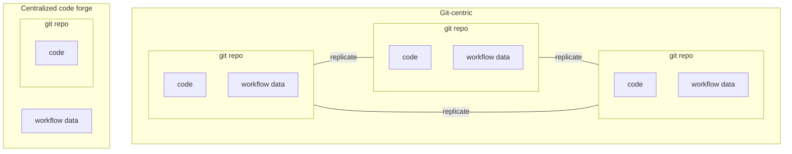

# :tada: :tada: :tada: Git-centric has achieved bootstrapping! Further development happens on Git-centric.

To report bugs, request features or contribute code, please use Git-centric, see the [Using the CLI](#using-the-cli) and [Using the Web interface](#using-the-web-interface) sections.

## Overview

Git-centric (GC thereafter) is a modestly decentralized local-first platform to support the familiar git workflows without depending on centralized code forge platforms (CG thereafter). It is modestly decentralized to aim for zero friction migration from CG while being 100% available.

## Architecture
GC achieves its goal of being modestly decentralized, deadly simple and crazily extensible by piggybacking the workflow data on git itself, contrasting CG's approach of storing them in privately managed databases.



Two example deployment scenarios:

1. Conservatively decentralized, just want business continuity when the CG is unavailable.

In this case, use GC with 8 CG providers. There is no setup cost. Unless all of them go down, you are good. And even if they do, you are most likely unscathed, because you automatically fall back to scenario 2:

2. More radically decentralized, but don't want any learning curve when migrating from the good old CG

In this case, the developer machines in your intranet form a replicating network for workflow data. The team is globally distributed? Use Tailscale, NetBird or ZeroTier. The project accepts outside/external/community/volunteer contribution? Just set up a repo in one CG as an ordinary node of your GC network. The CG repo serves as a gateway for external contributors to access your workflow.

GC has a 3 layer architecture:
1. Layer 1 (L1 thereafter) is the data format layer consisting of definitions of directory structures and file formats. [Here is a working instance](/yushih/git-centric/tree/__git-centric__).
2. Layer 2 is the reference implementation. Currently, there is a Python based CLI implementation in [pygc/src](pygc/src). This is meant to be used by CLI lovers, CI/CD tools and agents.
3. Layer 3 is the reference Web shell on top of layer 2 to expose the familiar Web UI. You can run the Web server on localhost and work on your git repo in your browser.

Also, there is simple gossip protocol to support decentralization.

## Advantages over CG:
1. the evolving history left by the workflow is preserved, instead of only the history of code changes.
2. open source, self-hosted and super simple design.
3. therefore, extendable. These days everybody wants to extend their system with agentic AI. GC doesn't get in the way.
4. highly available, GC can replicate to infinitely many git nodes and as long as there is one node up, the git workflow can progress normally. There is no single point of failure.

## Fundamental data structure

(L1)All GC data is stored in the "__git-centric__" branch under the "__git-centric__" directory. All file paths below are relative to this directory.

(L2)To initialize GC, run:
```gc init```
in the working directory. The Git repository must already exist (`git init`
creates one). 


## Pull requests
(L1)In the "pull-requests" directory, each open pull request is represented by a directory named "c~>b#id:t", where c is the compare branch name, b is the base branch name, id is an unique id and t is the title. If the name is prefixed with the status flag "[closed]", it is closed. If c is an ancestor of b, the pull request is considered to have been merged. If the name is prefixed with the status flag "[draft]", it is a draft pull request. Draft/ready, open/closed, and merged/not merged are independent: all eight combinations are valid. Both stored flags may be present, written as "[closed][draft]"; merged is determined by ancestry regardless of these flags. The author of the pull request is the creator of the pull request directory as recorded in git. The creation time the pull request is the timestamp of the commit that creates the directory.

(L2)To list pull requests, run

```gc pr list <optional filters>```

This command outputs PR IDs, titles, compare/base branches, author, creation time,
and draft/closed/merged flags. Filters combine with AND.

<optional filters> are one or more of:

```open```, filters out draft, closed and merged

```mine```

```author=<author>```

```compare=<branch name>```

```base=<branch name>```

```title=<regular expression>```

To create a pull request, run

```gc pr new <compare branch> <base branch> <title> [comment]```

Both branches must exist locally. Omit the optional comment for an empty
description, or use `@-` to read it from stdin.


To inspect one pull request, including its conversation and merge analysis, run:

```sh
gc pr show PR_ID
gc pr show PR_ID --text
```

The default JSON includes the PR record, all comments, merge-conflict status,
conflicting file paths, and changed-file details. File changes are measured on
the compare branch since its merge base with the base branch. Added, modified,
deleted and type-changed files are labeled; renamed/copied files include their
old and new paths and similarity percentage.

`--text` shows the same information with an indented comment tree. A comment
addressing several others is placed beneath its first reply target and explicitly
lists all targets. Merge analysis requires Git 2.38+ and leaves your checkout
and index untouched. Missing branches or unrelated histories produce an unknown
merge status with an explanation.

To modify a pull request, run

```gc pr update <pr id> <updates>```

where <updates> is one or more of:

```compare=<new compare branch name>```

```base=<new base branch name>```

```title=<new title>```

```close```, adds "[closed]" without changing draft status

```reopen```, removes "[closed]" without changing draft status

```draft```, makes the pull request draft without changing closed status

```ready```, removes the "[draft]" status without changing closed status

Actions on different states may be combined (for example, `close draft`).
Contradictory pairs `close reopen` and `draft ready` are errors.


## Pull request conversation
(L1)Each comment under a pull request is represented by the file "comment-id" where id is a unique id. The initial comment has id "main". Comment names can have one or more suffix ":id" where id is the comment that this comment addresses. Comment edits and deletions remain recorded in Git history. The current local
CLI does not restrict editing to the original author.

(L2)
To show comments, run

```gc pr comments <pr id>```

This lists comment IDs, text and reply targets as JSON. `gc pr comments` without
an ID.

To add a comment, run

```gc comment <pr id> <comment>```

or

```gc comment <pr id>:<comment id> <comment>```

which creates a comment addressing existing <comment id>.

If <comment> is "@-", it will be read from stdin.

You can also use the explicit `add` command and address several comments:

```sh
gc comment add PR_ID "Another comment"
gc comment PR_ID:main "Reply to the description"
gc comment PR_ID:COMMENT_ID:OTHER_COMMENT_ID "Reply to both"
```

To replace a comment's text or delete it:

```sh
gc comment update PR_ID:COMMENT_ID "Revised text"
gc comment update PR_ID:COMMENT_ID @-  # read replacement text from stdin
gc comment delete PR_ID:COMMENT_ID
```

Updating text preserves the comment ID and its reply targets. Deletion keeps
replies and their text, removing their links to the deleted comment. The `main`
description cannot be deleted; clear it with `gc comment update PR_ID:main ""`.
Previous contents remain available in Git history.

## Issues

(L1)Each issue is represented by a "<ID>:<encoded-title>" directory under the "issues/" directory.
The directory name is prefixed with `[closed]` if the issue is closed.
Titles use percent escaping.

Each comment under the issue is file named "comment-<ID>[:<REPLY_ID>...]".
The <ID> for the main content of the issue is "main". A comment can address zero or multiple <REPLY_ID>s.
Creator and creation time come from first-parent Git history by stable ID, so

(L2)

```sh
gc issue new "Fix login" "Steps to reproduce"
gc issue new "Fix login" @-              # description from stdin
gc issue list                            # all issues, ordered by ID
gc issue list open mine 'title=login.*'
gc issue list closed 'author=name@example.com'
gc issue show ISSUE_ID                    # JSON: issue and comments
gc issue show ISSUE_ID --text             # details and reply tree
gc issue update ISSUE_ID 'title=Revised title' close
gc issue update ISSUE_ID reopen
gc issue comments ISSUE_ID
gc issue comment add ISSUE_ID "More detail"
gc issue comment add ISSUE_ID:main "Reply to description"
gc issue comment add ISSUE_ID:COMMENT_ID @-
gc issue comment update ISSUE_ID:main "Revised description"
gc issue comment delete ISSUE_ID:COMMENT_ID
gc issue --help
```

## Using the CLI

See [installation and setup](pygc/README.md#requirements-and-setup) to install
`gc`. With the Python environment active, run the commands below directly;
otherwise use `uv run gc` from `pygc/`.

```sh
gc help                  # list commands
gc pr --help             # list pull request commands
gc issue --help          # list issue commands
gc comment --help        # list comment commands
gc pr show --help        # get help for a specific command
```

Repository commands use the current directory by default. To select another
repository, add `--repo-dir=/path/to/repo` after the command:

```sh
gc init --repo-dir=/path/to/repo
gc pr list --repo-dir=/path/to/repo
```

If both locations are initialized but refer to different repositories, `gc`
prints a warning and uses `--repo-dir`. Quote titles, comments and filter values
that contain spaces. Pull request and comment commands output JSON by default;
`gc pr show --text` provides a readable alternative.

## Using the Web interface

```sh
gc web
gc web --host 127.0.0.1 --port 9000
gc web --reload  # reload the server during development
```

`gc web` starts the local web server at http://127.0.0.1:8000 by default. Build
the frontend using the [setup instructions](pygc/README.md#requirements-and-setup)
first. The Code tab shows the selected branch, latest commit, and committed files.
Use the breadcrumbs to browse directories or History to inspect earlier revisions.
Issues and Pull requests support creation, editing, and threaded conversations.
Open Files changed on a pull request to review patches and merge conflicts.
Open Nodes to list participating Git endpoints, add a node, edit its URL, or remove it.

## Consensus protocol

GC substitutes consistency for mergability. Although not strictly a CRDT, the data formats are designed to reduce the likehood of conflict. GC maintains the list of participating nodes. Each workflow action first result in a local commit. The commit is then first optimistically pushed to every other participating nodes. If all pushes succeeds, then we are good. If some nodes are unreachable, or reject the push because there are new local update, the local node tries to reconcile.

(L1)The node list is in the __git-centric__/nodes/ directory of the __git-centric__ branch. Each node is represented by a directory, the directory name is the node name. In the node directory, the file "URL" contains the URL of the node.

(L2)
```gc node add <name> <URL>``` add a node <name> at <URL>
```gc node list``` list nodes

(L1)The finalization procedure is:

Input: branch (defaults to __git-centric__)
do
  newCommit = false
  conflictNodeSet = {}
  successNodeSet = {}
  for each node in the node list:
    push the current branch tip to the same branch on node
    if success:
      add node to successNodeSet
    else if rejected due to divergent history:
      fetch branch from node
      if reconciliation advances the local branch:
        newCommit = true
        break (restart with the new tip)
      else if merge conflict:
        add node to conflictNodeSet
        print "conflict with node" warning
      else:
        warn about the rejected push
    else:
      print peer warning
while newCommit

half = floor(totalNodeCount / 2):
if count(successNodeSet) > half:
  for each node in conflictNodeSet:
    fetch branch from node
    add a note "conflict: <node list>" to the remote branch, where <node list> is successNodeSet
    push the note to node
    if the above is unsuccessful, warn and continue
  return success
else if count(conflictNodeSet) > half:
  error: "conflict change"
else:
  add a "not finalized" git note to the head commit of branch
  warn: "no finality"

(L2)
```gc consensus finalize```: run the finalization procedure

Every successful CLI command finalizes by default. Pass `-do-not-finalize` or
`--do-not-finalize` to record a local "not finalized" note instead.


## Access control

The access control works by evaluating rules in Python againt the action initiator, the action name and detailed action parameters. The default implementation comes with a role-based access control (RBAC) mechanics. Conceptually, whether an action can be performed is determined the boolean outcome of the function: 

```EvalPython(Python program, user, user's role, role's metadata, action name, action parameters)```

The parameters `user`, `action name`, `action parameters` are supplied by the system, while all other parameters `Python program`, `user's role`, `role's metadata` are customizable.

This design affords superb flexibility while keeping a clean architecture. Users can do things such as:

1. mirror any organization structure

2. have uncoventional access control logic, such as a "cinderella" role that switches identify depending on whether the action is occuring before or after a designated time.

### The role database format

(L1)
Each roles is a file under the `__git-centric__/access-control/roles` directory. The file name is role name. The file content is the role metadata.

Each user is a directory under the `__git-centric__/access-control/users` directory. The name of the directory is the user name. Under each user directory, there is a `pk-Ed25519` file storing the Ed25519 public key of the user. Under each user directory, there is a `roles` directory, each file name in which is a role that the user belongs to.

(L2)
When `gc init` runs, it creates a `.__git-centric__sk-Ed25519` file in the user home directory storing the corresponding private key.It also creates default roles `owner`, `admin`, `ci` and `merger`. The creating user is an owner.


```gc access role list```: list roles, for each role show the users
```gc access role create <role name> [<role metadata>]```: create a role with optional metadata
```gc access role delete|remove <role name>```: delete a role, err if there are users in the role
```gc access role assign|unassign <user name> <role name>```: add/remove user to a role, <user name> can be `*` for all users


### Actions

(L1)No read operation is access-controlled.

Action | Parameters|
|-|-|
create pull request|base branch, compare branch|
merge pull request| pull request ID, base branch|
create issue||
comment on issue||
add role||
change role metadata|role name, new metadata|
add user|user name and roles|
delete user|user name|
change user public key|user name|
change user roles|user name, new roles|
add node|new node URL|
change node URL|node ID, node URL|
remove node|node ID, node URL|
change the rule scripts||

### Rules

The access control result is obtained by evaluating all Python scripts in `__git-centric__/access-control/rules/rule-*.py`. Each script exports a `eval` function that takes an action, the requesting user and its roles. `eval` should return `'grant'`, `'deny'`, None or an error. After all results are collected, deduplicated and removed of `None`, if the result set is {`'grant'`}, the access is granted; if the result set is {`'deny'`}, the access is denied; if the result set is {} or {`'grant'`, `'deny'`} or contains an error, or the `eval` function throwes an exception, the access is denied with an error message pointing out lack of result, conflicting results or presence of an error.

TODO
```gc merge <pr>```

